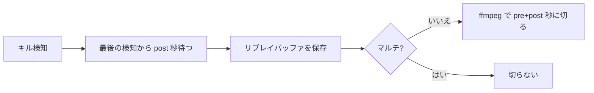

# LoL 自動クリップ保存ツール

League of Legends の試合中に、**自分のキルやオブジェクト取得を自動で検出して、OBS のリプレイバッファからクリップを保存**するツールです。
保存されたクリップは、**試合ごとのフォルダ**に自動で整理されます。

```
Videos\
 └ 2026-10-14_2130_Ahri\
     ├ 01_キル_03m42s.mp4
     ├ 02_ダブルキル_07m15s.mp4
     └ 03_バロン_24m08s.mp4
```

- Riot の API キーは**不要**です。
- ゲームのファイルやメモリには触れません。プレイ中に公開されている、ローカルの「Live Client Data API」を読むだけです。
- 録画ソフトは OBS Studio を使います。

## 保存される場面

| 場面 | 保存 |
|---|---|
| 自分のキル | ○ |
| 自分のアシスト | ○（`save_assist` でオフにできる） |
| ダブル〜ペンタキル | ○ |
| 自チームのバロン、ドラゴン、エース | ○（`save_objectives` でオフにできる） |
| 自分のデス | × |

短い間に続けて起きたイベントは、**1 つのクリップ**にまとまります。マルチキル中は検知のたびタイマーが更新され、**最後の検知**から待ち時間を数えます。

## クリップの長さ（pre / post）

`config.json` で **キル検知より前**と**キル後**を別々に指定します。クリップ全体はおよそ **前 + 後** です。

| 種類 | 設定項目 | 意味 |
|------|-----------|------|
| 単キル | `pre_sec_single` | 検知より**前**に入れたい秒数 |
| 単キル | `post_sec_single` | 最後の検知から**何秒後に保存**するか（＝キル後） |
| マルチ | `pre_sec_multi` | 最後の検知より**前**（連キル全体を含めたい長さ） |
| マルチ | `post_sec_multi` | 同上（キル後） |

例（`pre_sec_single: 30`, `post_sec_single: 10`）:

```
単キル:  |← 前30秒 →|検知|← 後10秒 →|保存  → 約40秒の動画
```

起動時、ツールは OBS のリプレイバッファ最大時間を **単・マルチの (pre+post) の大きい方**に合わせます。  
**単キル**だけ、保存後に **ffmpeg** で「前+後」の長さに末尾から切り詰めます。**マルチ**はそのまま保存します。



## 必要なもの

- Windows 10 / 11
- [OBS Studio](https://obsproject.com/) 28 以降（WebSocket が標準搭載）
- [Python](https://www.python.org/) 3.10 以降  
  - インストール時に **「Add python.exe to PATH」** にチェック
- **ffmpeg**（任意・推奨）  
  - 単キルクリップを `pre_sec_single + post_sec_single` に揃えるために使います。PATH に無い場合は単キルは OBS の保存長（バッファ最大）のままになります。

## セットアップ（最初の 1 回だけ）

### 1. OBS の設定

**WebSocket を有効にする**

1. 「ツール」→「WebSocket サーバー設定」
2. 「WebSocket サーバーを有効にする」にチェック
3. パスワードを控える（ポートは通常 `4455`）

**リプレイバッファを有効にする**

1. 「設定」→「出力」→「リプレイバッファ」
2. リプレイバッファを有効化
3. 「最大リプレイ時間」はツール起動時に自動変更されますが、手動の場合は **`pre_sec_multi + post_sec_multi` 以上**にしてください。
4. 録画形式は mp4 推奨

**ゲーム画面を追加する**

- 「ソース」に LoL の「ゲームキャプチャ」または「ウィンドウキャプチャ」を追加

### 2. LoL の音だけを入れる（任意）

1. 「設定」→「音声」で「デスクトップ音声」を無効
2. 「アプリケーション音声キャプチャ」を追加し、`League of Legends.exe` を選択（試合開始後に一覧に出ることがあります）

### 3. このツールを置く

同じフォルダに次がある状態にします（リポジトリを clone した場合はそのまま）。

| ファイル | 内容 |
|---|---|
| `get_lol_obs_autoclip.py` | 本体 |
| `start_autoclip.bat` | ダブルクリック起動・OBS 未起動時は起動を試行 |

`start_autoclip.bat` の `OBS_BIN` は、OBS のショートカットの **リンク先フォルダ**（`obs64.exe` がある `bin\64bit`）に合わせてください。

## 使い方

1. OBS を起動するか、`start_autoclip.bat` をダブルクリック（OBS が無ければ自動起動を試みます）
2. 初回のみ、OBS の WebSocket パスワードを入力 → `config.json` に保存
3. 「OBS接続OK。LoLの試合開始を待っています...」と出たら準備完了
4. 試合をプレイ。検知ログのあと `post_sec_*` 秒経って保存されます
5. 終了はコマンドプロンプトを閉じるか `Ctrl+C`

クリップは OBS の録画／リプレイ保存先の下に、試合フォルダが作られて入ります。

### PC 起動時に自動で動かす（任意）

1. `Win + R` → `shell:startup` と入力
2. `start_autoclip.bat`（またはそのショートカット）をこのフォルダに置く

## 設定を変える

`config.json` をメモ帳で編集し、ツールを再起動します。

| 項目 | 内容 | 初期値（コード上） |
|---|---|---|
| `obs_host` | OBS のある PC | `localhost` |
| `obs_port` | WebSocket ポート | `4455` |
| `obs_password` | WebSocket パスワード | 初回入力 |
| `my_name` | 名前が取れないときのゲーム名（タグなし） | 空 |
| `pre_sec_single` | 単キル：検知より前の秒数 | `15` |
| `post_sec_single` | 単キル：検知から保存までの秒数（後ろ） | `15` |
| `pre_sec_multi` | マルチ：最後の検知より前の秒数 | `45` |
| `post_sec_multi` | マルチ：検知から保存までの秒数（後ろ） | `15` |
| `save_assist` | アシストも保存 | `true` |
| `save_objectives` | バロン・ドラゴン・エース | `true` |
| `split_by_match` | 試合フォルダに分ける | `true` |

**互換:** 昔の `replay_sec_single` / `replay_sec_multi` だけ書いてある場合は、`replay − post` を「前」として読みます。

`config.json` を削除して起動すると、パスワード入力からやり直せます。

## よくあるトラブル

**OBS に接続できない（ConnectionRefused）**

- OBS が起動しているか、WebSocket が有効か、パスワード・ポートが `config.json` と一致しているか
- バッチから OBS を立ち上げた直後は WebSocket の準備に時間がかかることがある（`start_autoclip.bat` は待機あり）
- 先に OBS を手動起動してからバッチを実行して切り分け

**OBS が `locale/en-US.ini` で起動しない（バッチからだけ）**

- `start_autoclip.bat` の `OBS_BIN` を、デスクトップの OBS ショートカットと同じパスにする
- ショートカットの「作業フォルダ」が `bin\64bit` であることと揃える

**「待機中: ...」が続く**

- 試合前・ロード中は正常。試合中も名前不一致のときは `my_name` を設定

**キルしたのに保存されない**

- ログに「キル を検出」が出るか、リプレイバッファが動いているか

**クリップにキルが入らない / 前が足りない**

- `pre_sec_* + post_sec_*` が OBS の最大リプレイ時間を超えていないか（ツール起動ログの OBS バッファ秒数を確認）
- マルチは `pre_sec_multi` を長めに。単は ffmpeg が入っているか

**単キルだけ動画が長い**

- ffmpeg をインストールし PATH に通す

**pip / ライブラリ**

```text
python -m pip install requests obsws-python
```

**文字化け**

- `start_autoclip.bat` から起動する（UTF-8 用に `chcp 65001` 済み）

## 制限事項

- 試合中に PC 上で動かす必要があります（観戦・リプレイ中は対象外）
- 自分の視点の映像のみ（Live Client Data が有効なモード）
- 日本語名・特殊文字はフォルダ名から安全な文字だけ残します

## 注意

- Riot Games 公式ではありません。開発者ポリシーに従い自己責任で利用してください。
- 他プレイヤー情報の収集・公開用途には使わないでください。

## ファイル構成

| ファイル | 内容 |
|---|---|
| `get_lol_obs_autoclip.py` | 本体 |
| `start_autoclip.bat` | 起動用バッチ |
| `config.json` | 設定（初回作成・git 管理外推奨） |
| `clips_log.jsonl` | 保存ログ（自動作成） |
